# Ledger — DevOps Final Capstone Project

**Name:** Gauri Shukla
**Enrollment No.:** `24BCS10115`
**Session:** 21 — Final DevOps Project & Troubleshooting
**Repository:** https://github.com/gauri0508/ledger-capstone
**Pipeline run:** https://github.com/gauri0508/ledger-capstone/actions/runs/38895206289

Ledger is a small personal expense tracker: you add what you spent (amount, category, date, note),
filter by category, and the dashboard shows this month's total, the all-time total and the top
category. It is deliberately small so that the interesting part — how it travels from my laptop
to a monitored Kubernetes cluster — can be shown end to end.

```
Developer ──► Git ──► GitHub Actions ──► Docker images ──► Trivy gate ──► Registry (GHCR)
                            │                                                   │
                            │   pytest + ruff + frontend build                  ▼
                            │                                            helm upgrade --install
                            ▼                                                   │
                      Terraform ──► AWS VPC + EKS                               ▼
                                                                  Kubernetes (Ingress, HPA)
                                                                     frontend ─► backend ─► Postgres
                                                                                  │
                                                                     Prometheus ◄─┘ (ServiceMonitor)
                                                                     Grafana
```

| Layer | What I used |
|---|---|
| Frontend | React 18 + Vite, served by unprivileged nginx (multi-stage image) |
| Backend | FastAPI, SQLAlchemy 2, Pydantic, Alembic migrations, Prometheus instrumentator |
| Database | PostgreSQL 16 (StatefulSet + PVC in Kubernetes, container in Compose) |
| Tests | pytest (13 tests, throw-away SQLite DB), ruff lint |
| Containers | Docker, Docker Compose, non-root users in both images |
| CI/CD | GitHub Actions: test → build + Trivy scan + push (SHA tags) → Helm deploy |
| Infra as code | Terraform: VPC (2 AZ, public + private subnets, NAT) + EKS cluster + managed node group |
| Kubernetes | Helm chart: Deployments, ClusterIP Services, Secret, ConfigMap, StatefulSet, Ingress, HPA, ServiceMonitor |
| Observability | kube-prometheus-stack: Prometheus scrapes `/metrics`, Grafana dashboard |

## Repository structure

```
ledger-capstone/
├── backend/                 FastAPI app (app/), Alembic migrations (alembic/), tests (tests/), Dockerfile
├── frontend/                React + Vite app (src/), nginx.conf, multi-stage Dockerfile
├── docker-compose.yml       the full local stack: postgres + backend + frontend
├── .github/workflows/       ci-cd.yml — the pipeline
├── terraform/               VPC + EKS (vpc.tf, eks.tf, provider.tf, variables.tf, outputs.tf, terraform.tfvars.example)
├── helm/ledger/             the Helm chart (Chart.yaml, values*.yaml, templates/)
├── k8s/                     namespace.yaml (with Pod Security Admission labels)
├── monitoring/              kube-prometheus-stack values + Grafana dashboard (JSON + ConfigMap)
├── troubleshooting/         deliberately broken manifests used in the lab below
├── scripts/                 load-test.sh for the HPA demo
└── docs/screenshots/        every screenshot referenced in this README
```

## Two things to know before reading the evidence

- **The pipeline ran twice over: on GitHub and locally.** On GitHub (run linked above) the `test` and
  `build-scan-push` jobs ran on a hosted runner and pushed the SHA-tagged images to **GHCR**. The `deploy`
  job is gated on a repository variable (`DEPLOY_ENABLED`) because a GitHub-hosted runner cannot reach the
  Minikube cluster on my laptop, so it shows as *skipped* there. To prove the deploy job too, the
  *identical* workflow file was executed locally with [`act`](https://github.com/nektos/act) against
  Minikube (`.actrc`: `--var REGISTRY=localhost:5000 --var DEPLOY_ENABLED=true`), where all three jobs
  ran green. Both sets of logs are below.
- **Terraform ran against [LocalStack](https://localstack.cloud)**, not a real AWS account (I don't have one
  on this machine). LocalStack's free edition emulates EC2 and IAM but not EKS, so the VPC/subnet/NAT/IAM
  layer was applied for real and the EKS layer is validated with `terraform plan`. The HCL is unchanged
  for real AWS: `use_localstack = false` switches the provider to the normal credential chain.

Everything else — the app, tests, images, scans, Helm release, Ingress, HPA, Prometheus, Grafana and the
troubleshooting lab — ran for real on a Minikube cluster (docker driver, Kubernetes v1.37).

---

# 1. Application — frontend + backend + database

## Run it

```bash
docker compose up --build        # UI http://localhost:3000, API docs http://localhost:8000/docs
docker compose down -v           # stop and delete the database volume
```

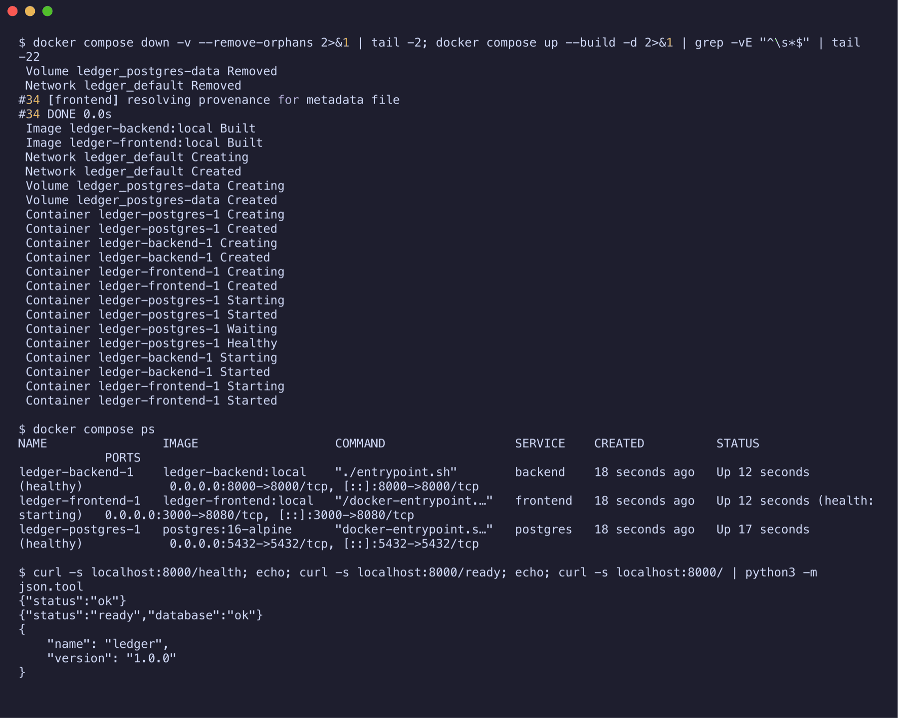

## The UI

The dashboard has four KPI cards, an add-expense form and a filterable table. It is responsive: on a
phone the cards go two-up and the form stacks.

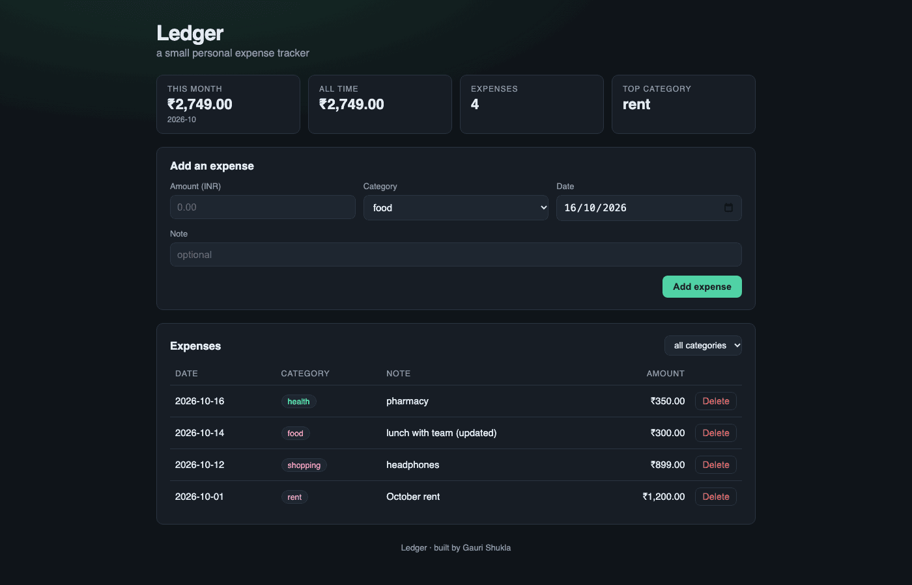

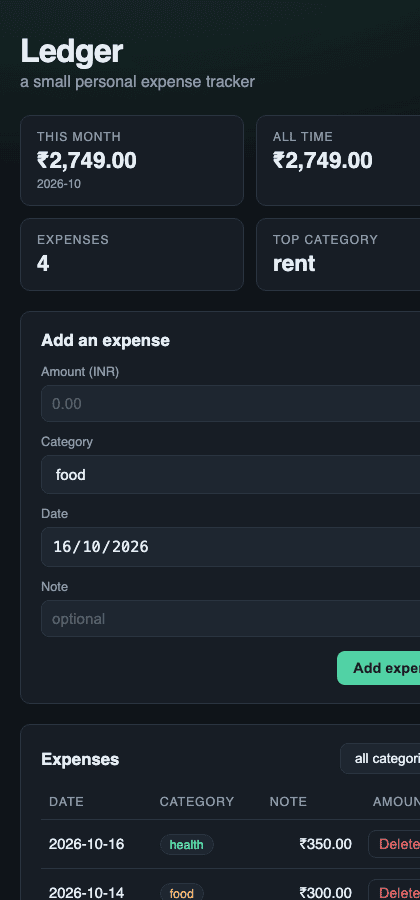

## The API

| Method | Path | What it does |
|---|---|---|
| `GET` | `/api/expenses?category=` | list, newest first, optional category filter |
| `POST` | `/api/expenses` | create (201); validation: amount > 0, category required |
| `GET` | `/api/expenses/{id}` | one expense (404 if missing) |
| `PUT` | `/api/expenses/{id}` | full update |
| `DELETE` | `/api/expenses/{id}` | delete (204) |
| `GET` | `/api/expenses/summary` | totals, this month's total, top category, per-category breakdown |
| `GET` | `/health` | liveness — the process is up, never touches the DB |
| `GET` | `/ready` | readiness — runs `SELECT 1` against Postgres, 503 if it fails |
| `GET` | `/metrics` | Prometheus exposition format |

Swagger UI at `/docs`:

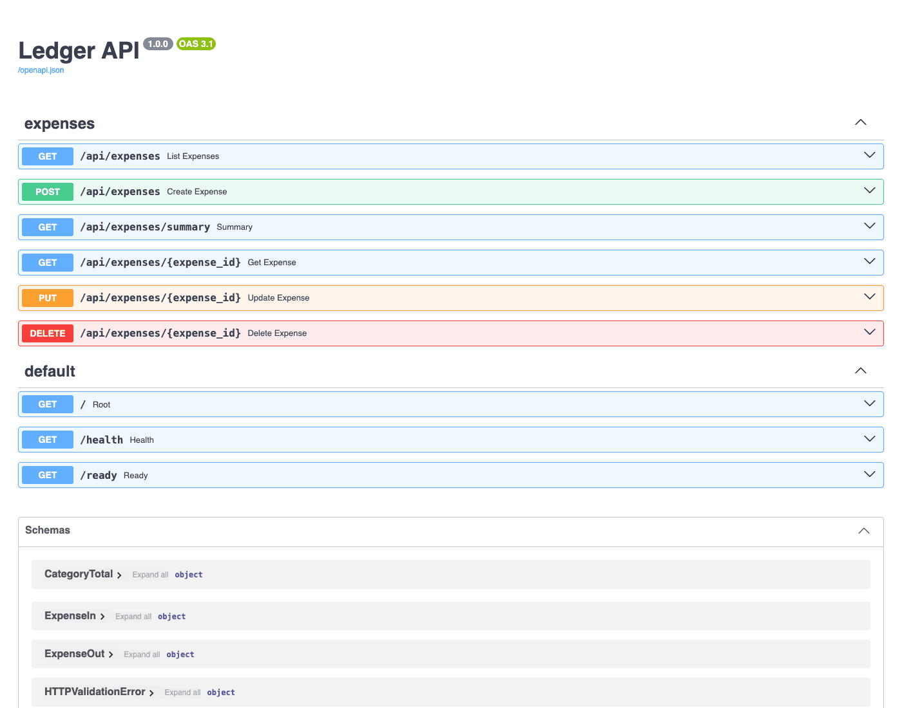

The whole CRUD cycle with curl — create, list, get, update, filter, summary, delete → 404, and a
validation error (422) for a negative amount:

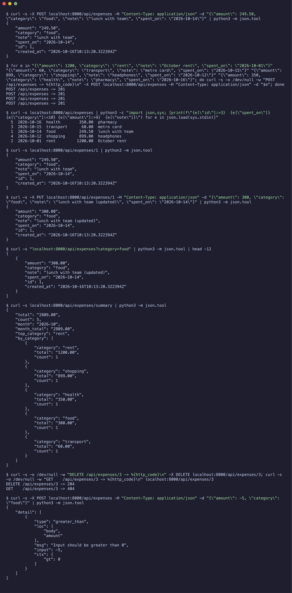

## The database

The schema is owned by Alembic (`backend/alembic/versions/0001_create_expenses.py`). The backend
container runs `alembic upgrade head` before starting uvicorn, so a fresh database always ends up at the
right revision. `alembic_version` holds the current revision, `expenses` is the table:

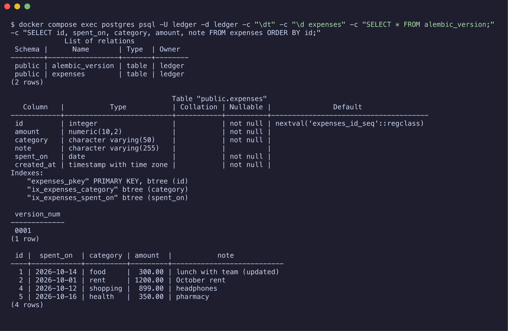

---

# 2. Testing — pytest + code quality

- 13 tests in `backend/tests/test_api.py` covering 7 endpoints: `/`, `/health`, `/ready`, `/metrics`, and
  the full CRUD + summary of `/api/expenses` (happy paths, 404s, 422 validation, empty-DB summary).
- `backend/tests/conftest.py` sets `DATABASE_URL` to a **temporary SQLite file** before the app is imported,
  and drops/recreates the tables around every test. The production database is never touched.
- `backend/pytest.ini` sets `testpaths` and `pythonpath`; `backend/ruff.toml` configures the linter.
- The pipeline runs `ruff check` and `pytest` *before* any image is built. The last block of the
  screenshot shows what happens when a test fails: the run goes red and the build job never starts.

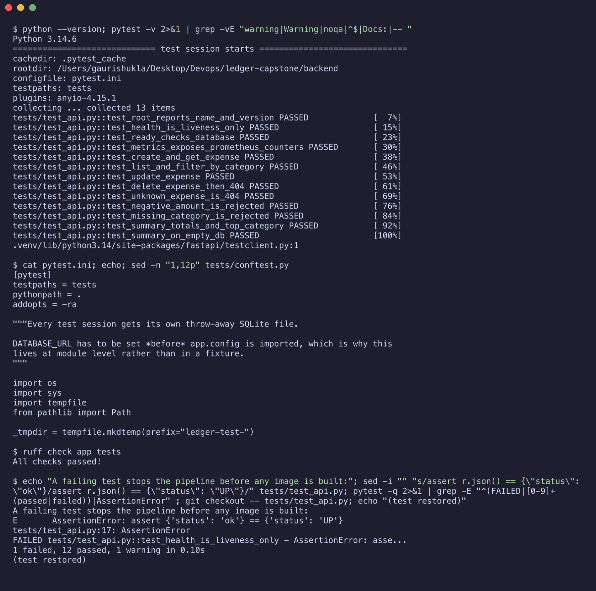

```bash
cd backend && python -m venv .venv && . .venv/bin/activate
pip install -r requirements.txt ruff
ruff check app tests && pytest -v
```

---

# 3. Git and GitHub

Public repository: **https://github.com/gauri0508/ledger-capstone**. The project was built as a series
of small, meaningful commits (one concern each: backend, tests, Dockerfile, frontend, chart, pipeline,
…). `.gitignore` excludes `.env`, `__pycache__`, `.venv`, `node_modules`, `dist`, Terraform state and
plans, and tool caches. No credentials are committed anywhere (the Terraform example file has none, the
pipeline reads everything from repository secrets).

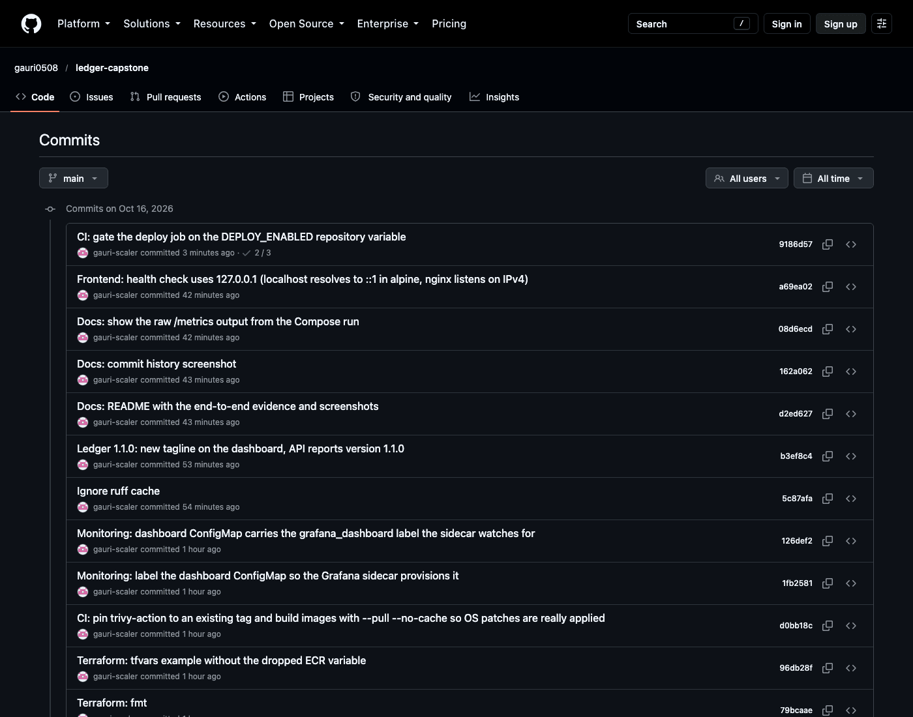

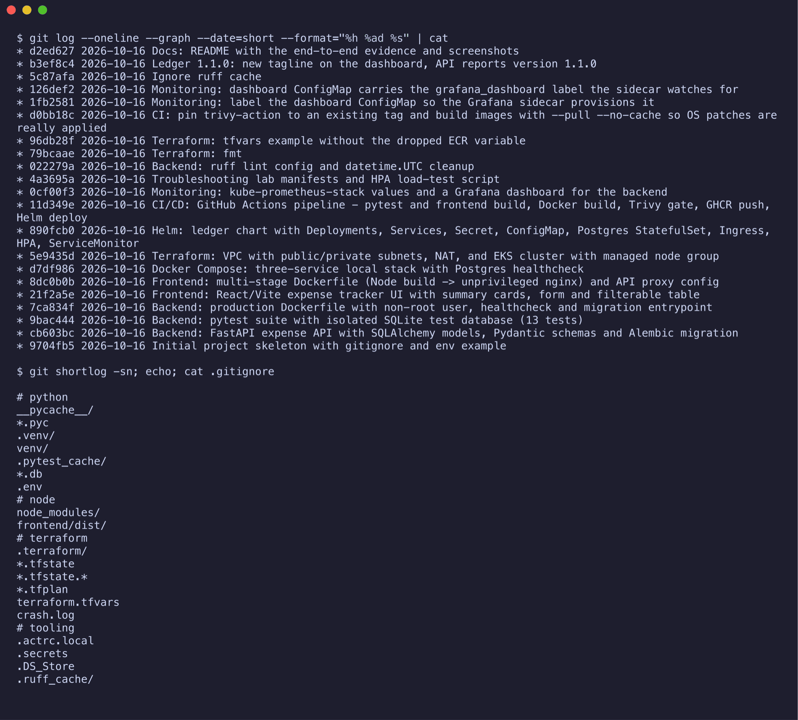

---

# 4. Docker — Dockerfiles + Compose

**`backend/Dockerfile`** — `python:3.12-slim`, dependencies installed first (cache-friendly), creates
system user `ledger` (uid 10001) and switches to it, `HEALTHCHECK` on `/health`, entrypoint runs the
migration and then uvicorn.

**`frontend/Dockerfile`** — two stages: `node:22-alpine` runs `npm ci && npm run build`, then only the
`dist/` folder is copied into `nginxinc/nginx-unprivileged:1.29-alpine` (runs as uid 101, listens on
8080). Node, npm and `node_modules` are not in the final image. `nginx.conf` serves the SPA and proxies
`/api/`, `/health`, `/ready`, `/metrics` to `http://backend:8000` — the browser never needs to know the
backend's address, the same config works in Compose and in Kubernetes.

**`docker-compose.yml`** — three services; the backend waits for Postgres's healthcheck before starting.

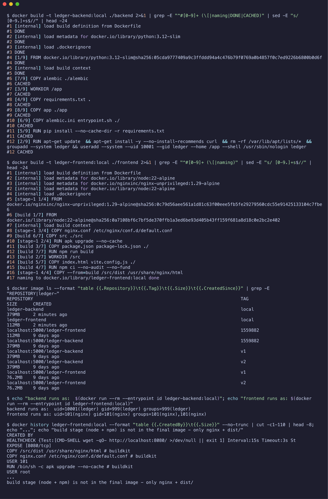

---

# 5. CI/CD — GitHub Actions

`.github/workflows/ci-cd.yml` triggers on every push and pull request to `main` and has three jobs:

```
test  ──►  build-scan-push  ──►  deploy
```

| Job | Steps |
|---|---|
| **test** | checkout → setup-python → `pip install` → `ruff check` → `pytest -v` (JUnit artifact) → setup-node → `npm ci && npm run build` (dist artifact) |
| **build-scan-push** | login to GHCR → `docker build --pull --no-cache` backend and frontend, tagged **`<registry>/<owner>/ledger-<name>:<git SHA>`** → Trivy scan each image (HIGH/CRITICAL, fixable, `exit-code: 1`) → `docker push` |
| **deploy** (main only) | setup-kubectl + setup-helm → kubeconfig from the `KUBE_CONFIG_DATA` secret → `kubectl apply -f k8s/namespace.yaml` → `helm upgrade --install ledger ./helm/ledger -f values-dev.yaml --set-string backend.image.tag=$GITHUB_SHA ... --wait` → smoke test through the Services |

The image tag is the commit SHA, never only `latest`, so every running pod can be traced back to the
exact commit that produced it (`kubectl get pods -o jsonpath=...image` in section 8 shows it).

## The run on GitHub

Push to `main` → run [#1](https://github.com/gauri0508/ledger-capstone/actions/runs/38895206289): `test`
26 s, `build-scan-push` 1 m 45 s, both green; `deploy` skipped (gated, see above); two artifacts
(`pytest-report`, `frontend-dist`).

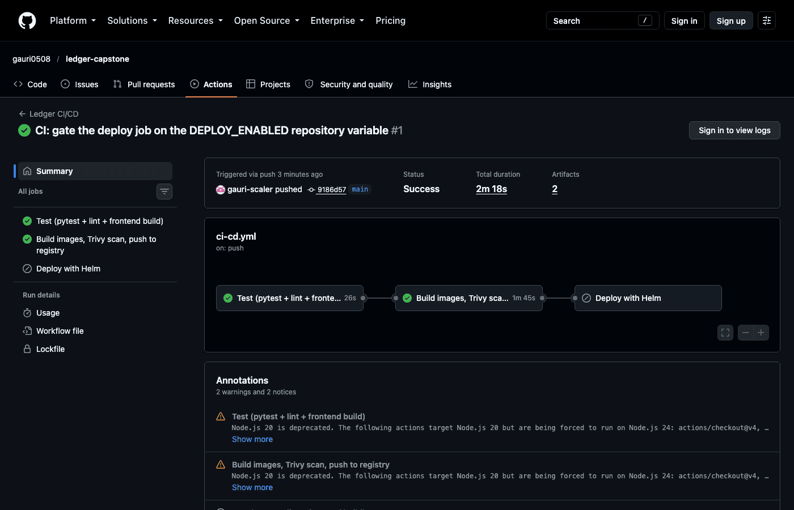

The test job's log on the hosted runner (`gh run view --log`):

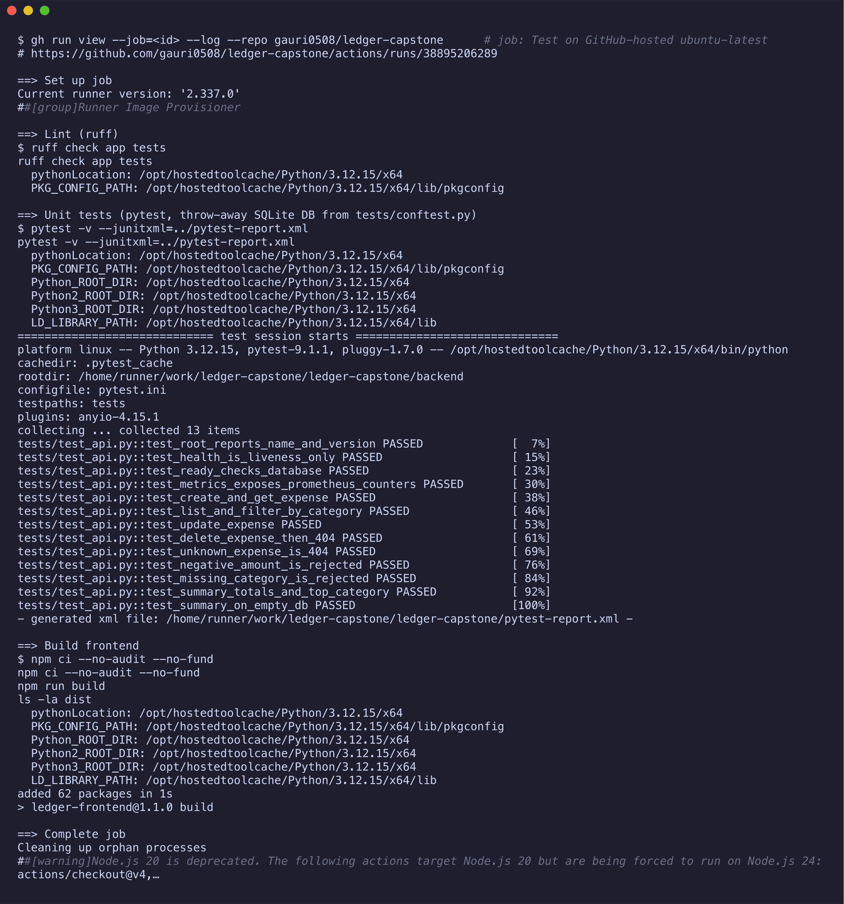

The build job's log: images built and tagged `ghcr.io/gauri0508/ledger-<name>:<sha>`, both Trivy scans
clean, both pushed to GHCR with the SHA tag:

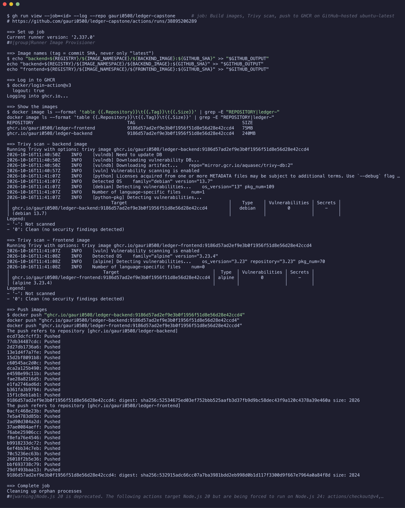

GHCR after the run — the two packages queried through the registry's own API, each with exactly one
tag equal to the commit SHA, and the backend image pulled back from GHCR by that tag:

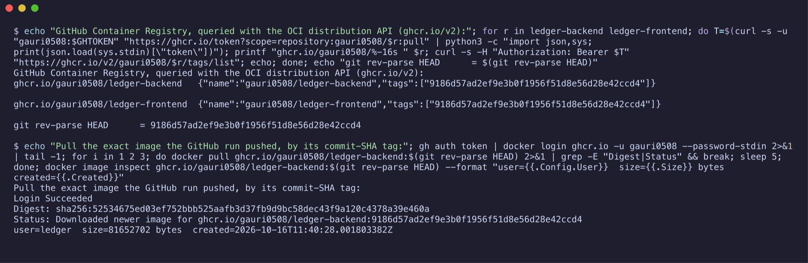

## The same workflow run locally with `act` (all three jobs, including deploy)

Job 1 — tests, lint and the frontend build:

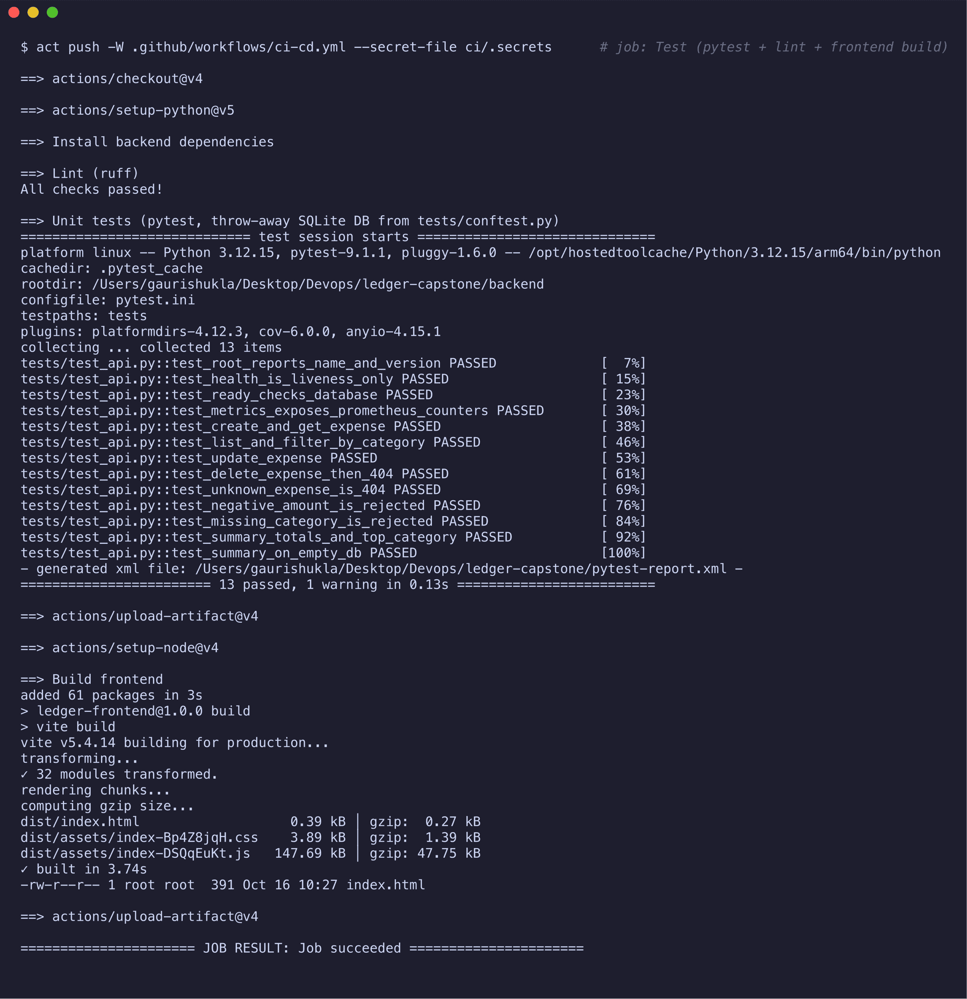

Job 2 — image build, both Trivy scans clean, push with SHA tags:

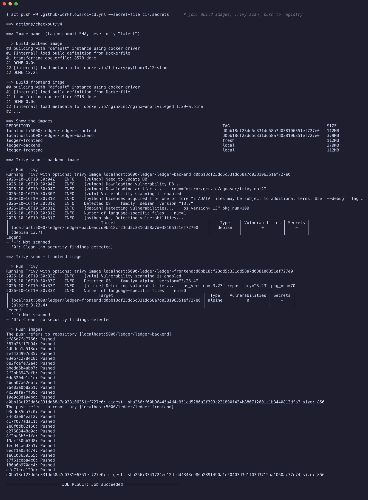

Job 3 — Helm deploy to the cluster and the smoke test:

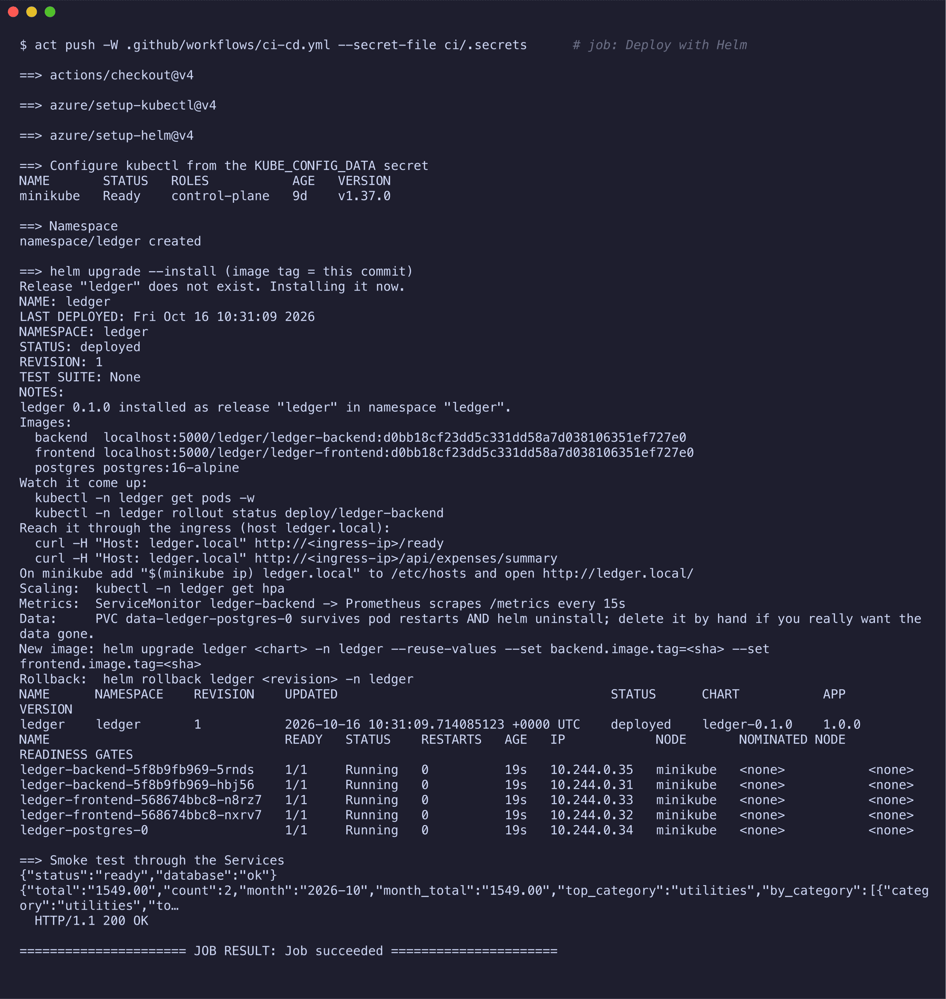

The Minikube registry after the local run — two repositories, one tag each, and the tag equals
`git rev-parse HEAD`:

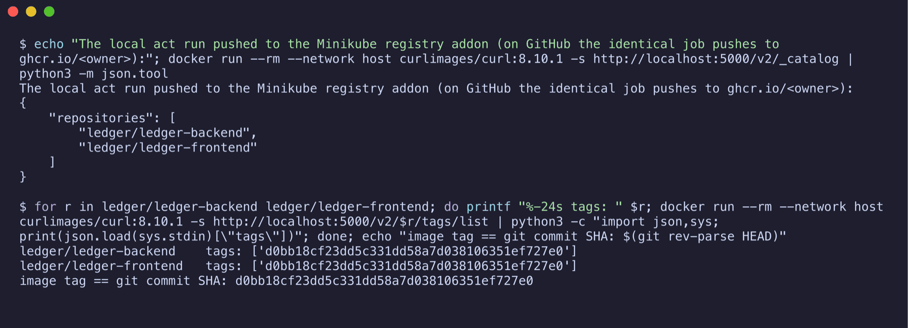

**Secrets and variables on GitHub:** `KUBE_CONFIG_DATA` (base64 of a kubeconfig for the target cluster)
and `POSTGRES_PASSWORD` are repository secrets; `GITHUB_TOKEN` is provided automatically for the GHCR
login. The deploy job additionally requires the repository variable `DEPLOY_ENABLED=true`, because a
GitHub-hosted runner can only deploy to a cluster it can reach (EKS yes, my laptop's Minikube no). With
the variable unset, pushes to GitHub run test + build-scan-push and publish to GHCR; the deploy job is
skipped and was exercised locally with `act` against Minikube instead. Nothing is hard-coded in the
workflow.

---

# 6. DevSecOps — Trivy

Both images are scanned in the pipeline with `aquasecurity/trivy-action` for **HIGH and CRITICAL**
vulnerabilities; `ignore-unfixed: true` and `exit-code: 1` mean *any finding that already has a fix
fails the job*, so a vulnerable image is never pushed or deployed. The same scan run locally:

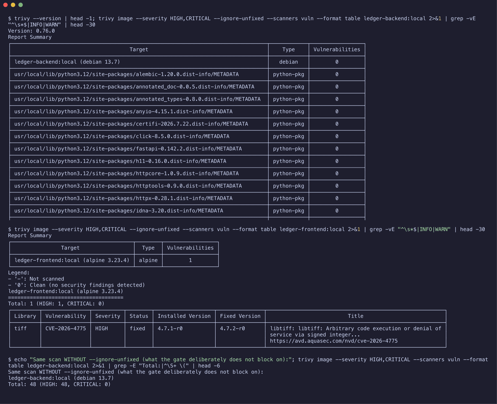

**What Trivy scanned and what it found.** Trivy inspects the OS package database of each image
(Debian 13 for the backend, Alpine 3.23 for the frontend) and the Python packages in the backend, and
matches every package version against its vulnerability database. The first local scan of the frontend
image reported one fixable HIGH: **CVE-2026-4775 in `libtiff` 4.7.1-r0** (fixed in 4.7.2-r0) coming
from the nginx base image. The Dockerfile already runs `apk upgrade` to pull in distro security updates —
the problem was that Docker had *cached* that layer from an older build, so the upgrade never re-ran.
The fix is in the pipeline: images are built with `--pull --no-cache`, which forces a fresh base image and
a real `apk upgrade`, after which both scans are clean (the job 2 screenshot above). The backend's 48
HIGH findings *without* `--ignore-unfixed` are Debian packages that have no patched version yet; the
gate deliberately does not block on those, because nothing I change in the image can fix them today.

---

# 7. Terraform — AWS infrastructure as code

`terraform/` describes what the production deployment would run on:

| File | Creates |
|---|---|
| `vpc.tf` | VPC `10.0.0.0/16`, 2 public + 2 private subnets across `ap-south-1a/b`, Internet Gateway, one NAT Gateway + EIP, public and private route tables, the extra cluster security group, and the `kubernetes.io/role/*` subnet tags |
| `eks.tf` | IAM roles for the control plane and the nodes (with the three managed policies), the EKS cluster (API + ConfigMap auth, private + public endpoint), a managed node group (`t3.medium`, 1–3 nodes), the `vpc-cni`/`coredns`/`kube-proxy` add-ons and the OIDC provider for IRSA |
| `provider.tf` | the AWS provider; every LocalStack-specific setting is gated on `var.use_localstack` |
| `variables.tf` / `outputs.tf` | all knobs with validation; outputs include the `aws eks update-kubeconfig` command |
| `terraform.tfvars.example` | example values — **no credentials**; keys come from `aws configure`/env vars |

```bash
cd terraform
terraform init && terraform fmt -check -recursive && terraform validate
terraform plan -out=tfplan
terraform apply tfplan                       # real AWS: -var use_localstack=false
aws eks update-kubeconfig --region ap-south-1 --name ledger-dev
terraform destroy
```

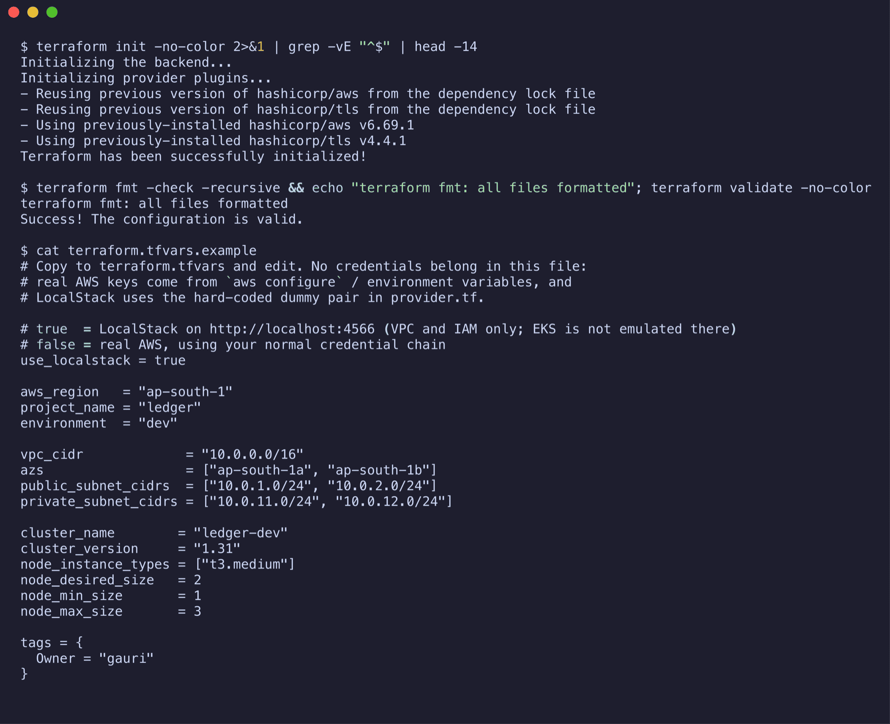

The plan: 27 resources, nothing to change or destroy:

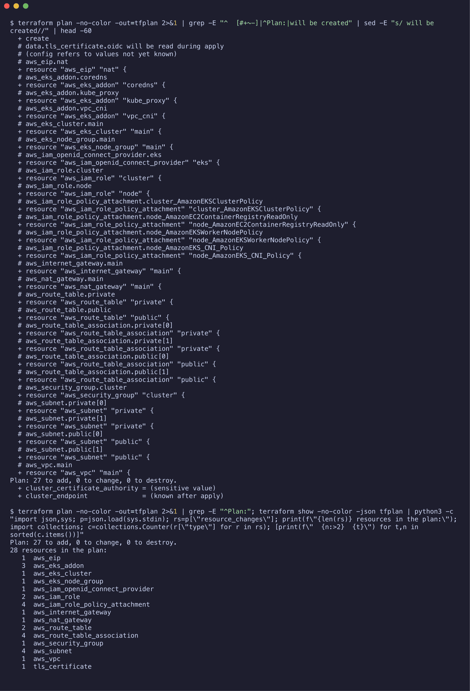

Apply against LocalStack — the 21 network + IAM resources are created:

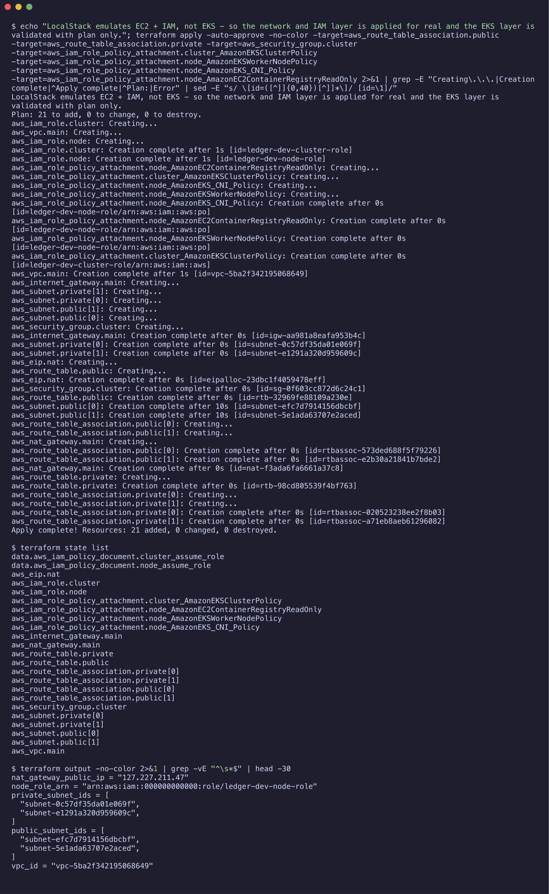

Verified independently of Terraform with the AWS CLI: the VPC, four subnets in two AZs (public ones with
auto-assign public IP), the route tables (`0.0.0.0/0 → igw` for public, `→ nat` for private), the NAT
Gateway and the two IAM roles:

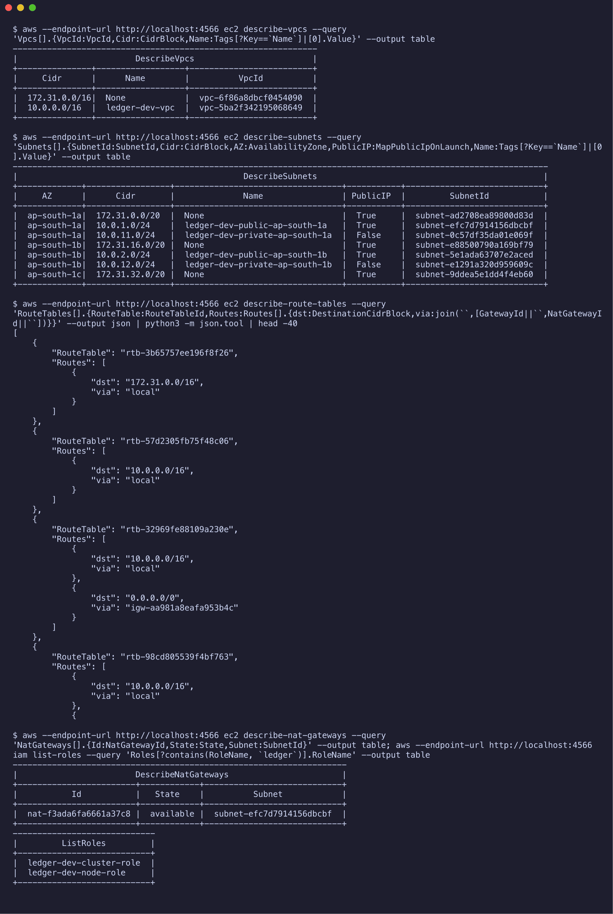

Where the emulation stops — a full apply hits `CreateCluster` and LocalStack answers 501 (EKS is not
emulated); the EKS layer is shown as a plan instead:

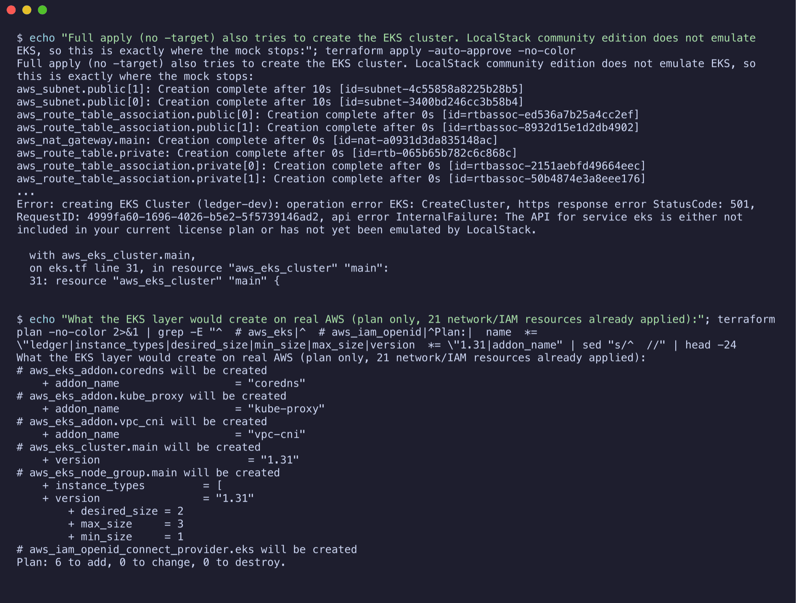

And `terraform destroy` tears everything down (0 resources left in state):

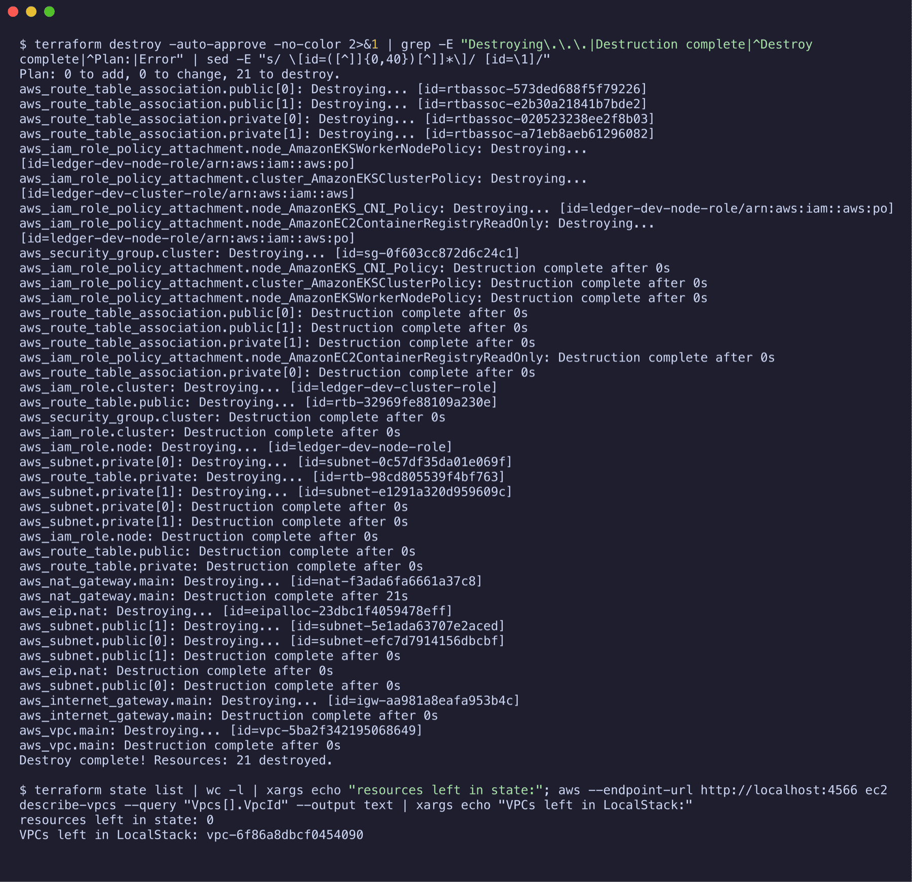

---

# 8. Kubernetes + Helm

`k8s/namespace.yaml` creates the `ledger` namespace with Pod Security Admission labels
(`enforce: restricted`), so any pod that runs as root, allows privilege escalation or keeps Linux
capabilities is rejected by the API server — the chart's `securityContext`s are written to pass that.

`helm/ledger/` is the chart. `values.yaml` holds the defaults, `values-dev.yaml` (Minikube) and
`values-prod.yaml` override registry, replicas, resources, hostname and TLS.

| Template | Object |
|---|---|
| `backend-deployment.yaml` | 2 replicas, RollingUpdate `maxUnavailable: 0`, init containers *wait-for-postgres* and *migrate* (`alembic upgrade head`, retried), startup/liveness/readiness probes, env from ConfigMap + Secret |
| `frontend-deployment.yaml` | 2 replicas of the nginx image |
| `backend-service.yaml`, `frontend-service.yaml`, `postgres-service.yaml` | ClusterIP Services `backend:8000`, `frontend:8080`, headless `postgres:5432` |
| `postgres-statefulset.yaml` | Postgres 16 with a 1 Gi PVC (`volumeClaimTemplates`) |
| `secret.yaml`, `configmap.yaml` | credentials and `DATABASE_URL` (Secret), log level / CORS (ConfigMap) |
| `ingress.yaml` | host `ledger.local`: `/api`, `/health`, `/ready`, `/metrics` → backend, `/` → frontend |
| `backend-hpa.yaml` | HPA 2–5 replicas at 60 % CPU |
| `backend-servicemonitor.yaml` | tells the Prometheus Operator to scrape `/metrics` every 15 s |

```bash
kubectl apply -f k8s/namespace.yaml
helm upgrade --install ledger ./helm/ledger -n ledger -f helm/ledger/values-dev.yaml \
  --set-string backend.image.tag=<sha> --set-string frontend.image.tag=<sha> --wait
```

The release as the pipeline left it — pods all `Running` (2 backend, 2 frontend, 1 postgres), the three
ClusterIP Services with their endpoints, the bound PVC, the Ingress with an address, the HPA, and every
pod's image tag equal to the commit SHA:

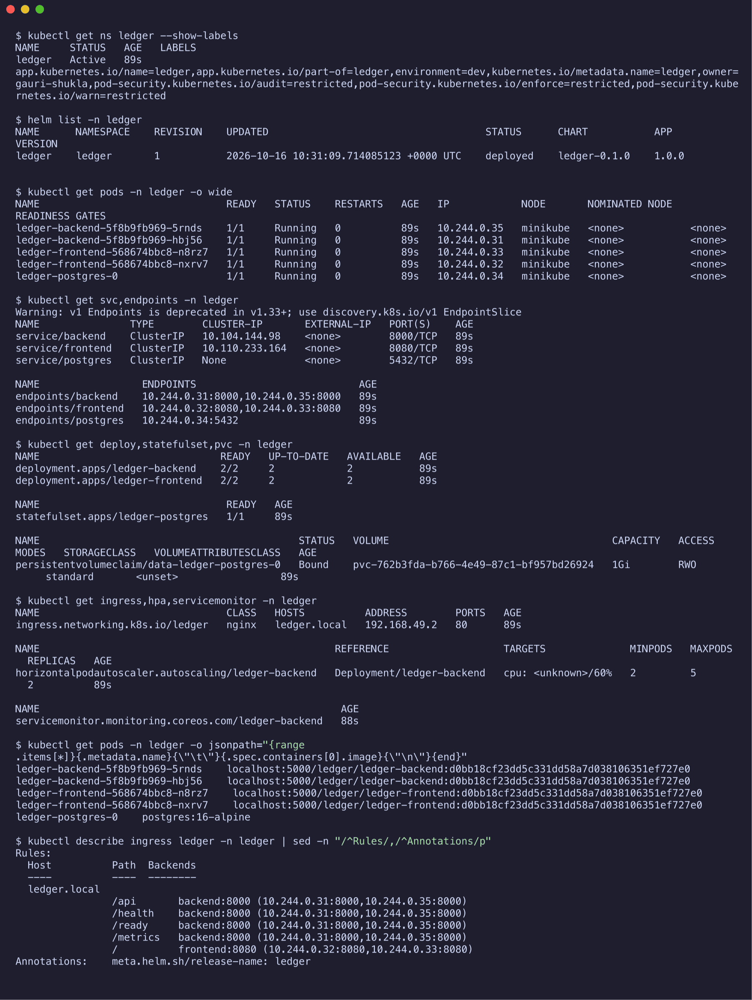

## Ingress

The ingress-nginx addon is the controller. Through it `/` serves the SPA and `/api` reaches the backend.
Fresh data was entered through the Ingress with curl, and the page below was loaded via
`http://ledger.local/` (hostname mapped to the Minikube ingress):

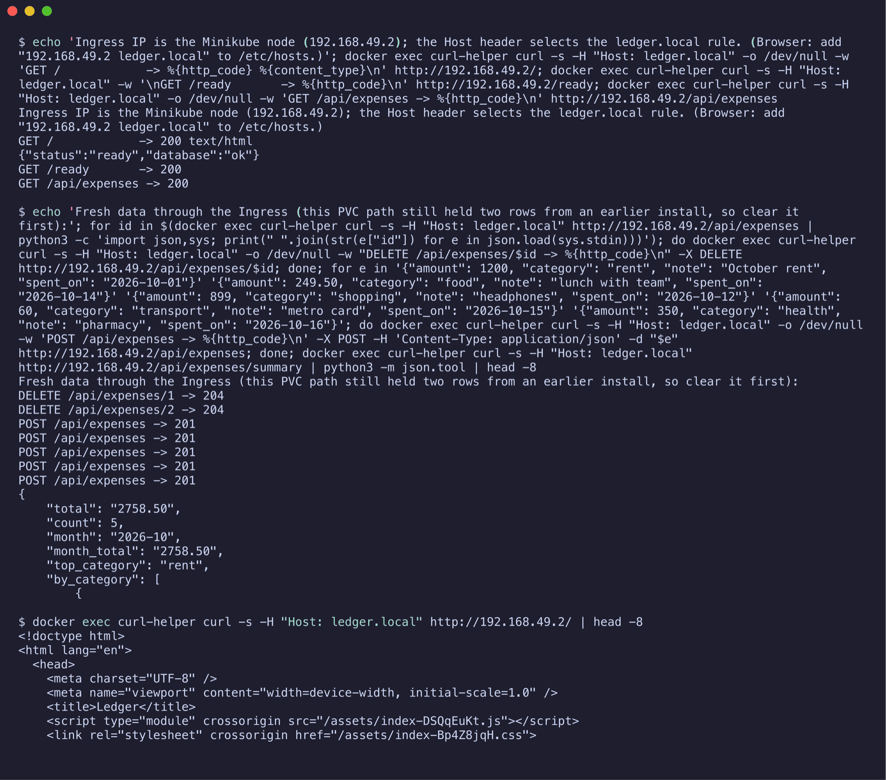

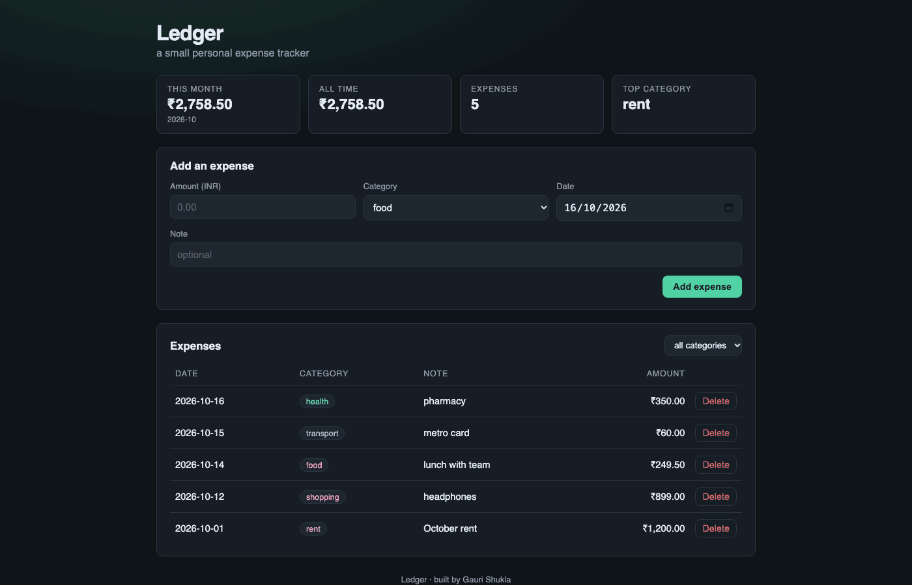

## Autoscaling (HPA)

`kubectl get hpa` at idle, then four busybox pods hammering `/api/expenses/summary`
(`scripts/load-test.sh` does the same from outside). CPU went from 3 % to 278 % of the request and the
HPA scaled the backend from 2 to 5 replicas (its maximum) within a minute; a few minutes after the load
was removed (CPU back at 2 %, stabilisation window elapsed) it scaled back down to 2:

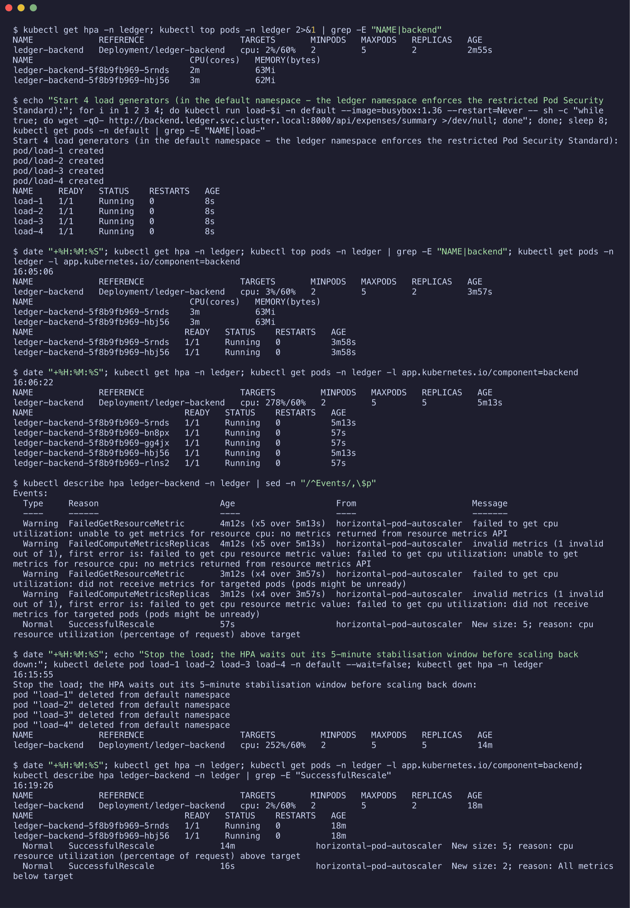

---

# 9. Observability — Prometheus + Grafana

The backend exposes `/metrics` via `prometheus-fastapi-instrumentator` (`http_requests_total`,
`http_request_duration_seconds` histograms per handler/method/status). kube-prometheus-stack is
installed from `monitoring/prometheus-values.yaml` (`serviceMonitorSelectorNilUsesHelmValues: false` so it
picks up ServiceMonitors from any namespace). The chart's ServiceMonitor selects the backend Service;
Prometheus discovers every backend pod behind it.

What the endpoint looks like after the Compose session's requests (one counter per handler, method and
status, plus the latency histograms):

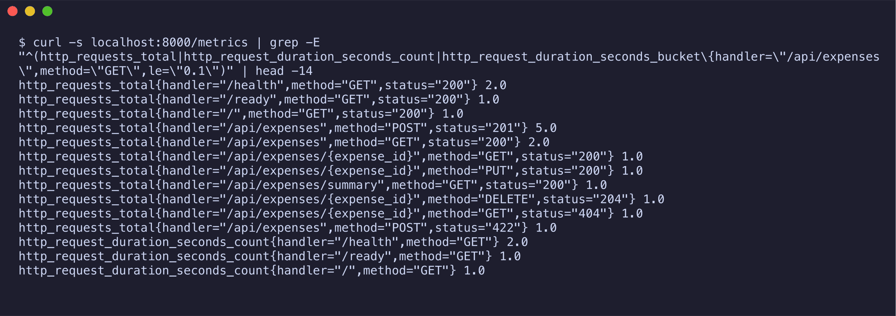

In the cluster: the raw endpoint through the Ingress, the ServiceMonitor spec and the Prometheus targets
API — both backend pods `up`:

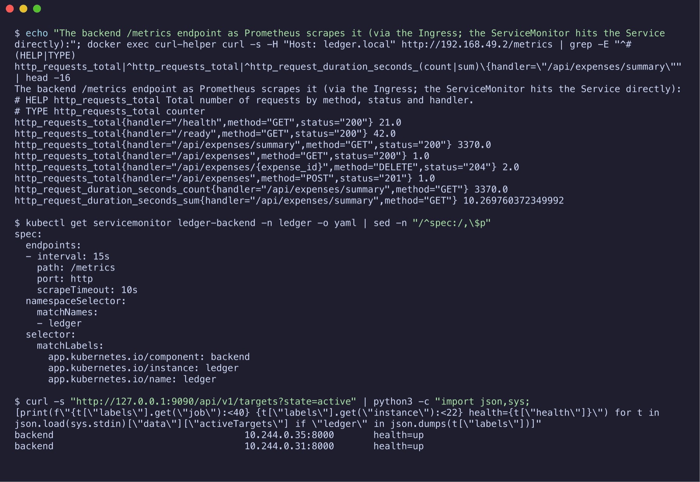

Prometheus → Status → Targets, filtered on `ledger`:

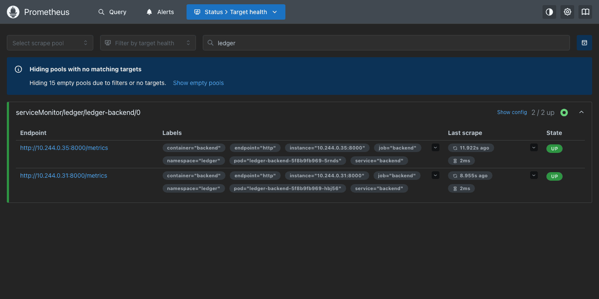

Request rate by handler and status during the load test — about 1 100 requests/s hitting
`/api/expenses/summary`:

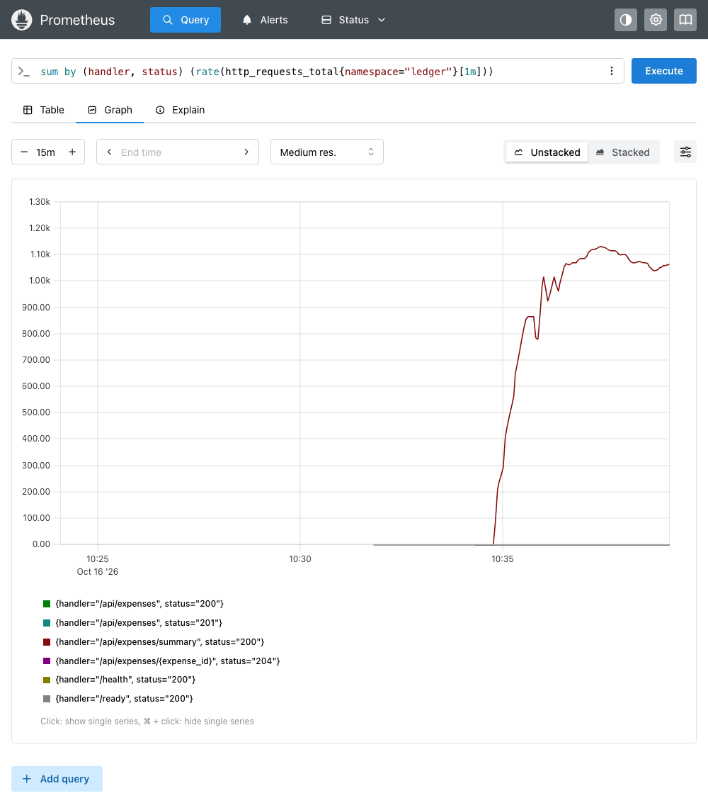

The Grafana dashboard (`monitoring/grafana-dashboard-ledger.json`, provisioned by the ConfigMap in
`monitoring/grafana-dashboard-configmap.yaml` which Grafana's sidecar picks up): requests/s by status,
p95 latency per handler, 5xx ratio, available backend replicas (2 → 5 as the HPA scaled), CPU and memory
per pod:

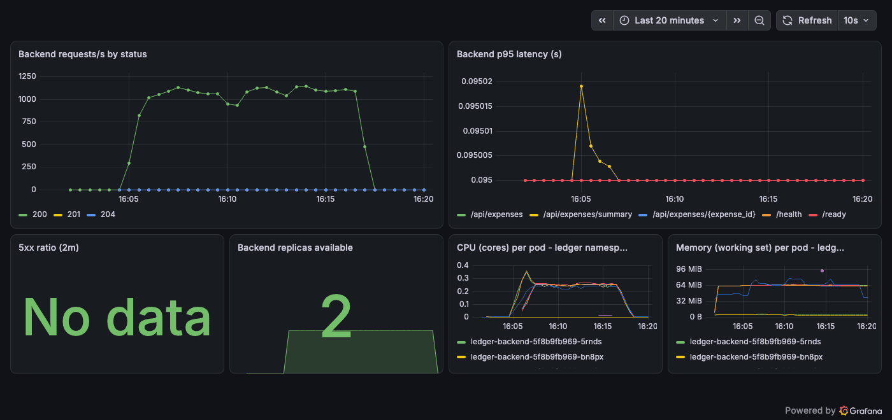

---

# 10. Troubleshooting lab

## `troubleshooting/broken-image.yaml` — ImagePullBackOff

A Deployment whose image tag was never built. `kubectl get pods` shows `ImagePullBackOff`,
`kubectl describe pod` and `kubectl get events` show the kubelet failing to pull
`ledger-backend:does-not-exist`. Root cause: wrong tag. Fix: `kubectl set image` to the tag the pipeline
actually pushed (the commit SHA) → rolled out, `Running`.

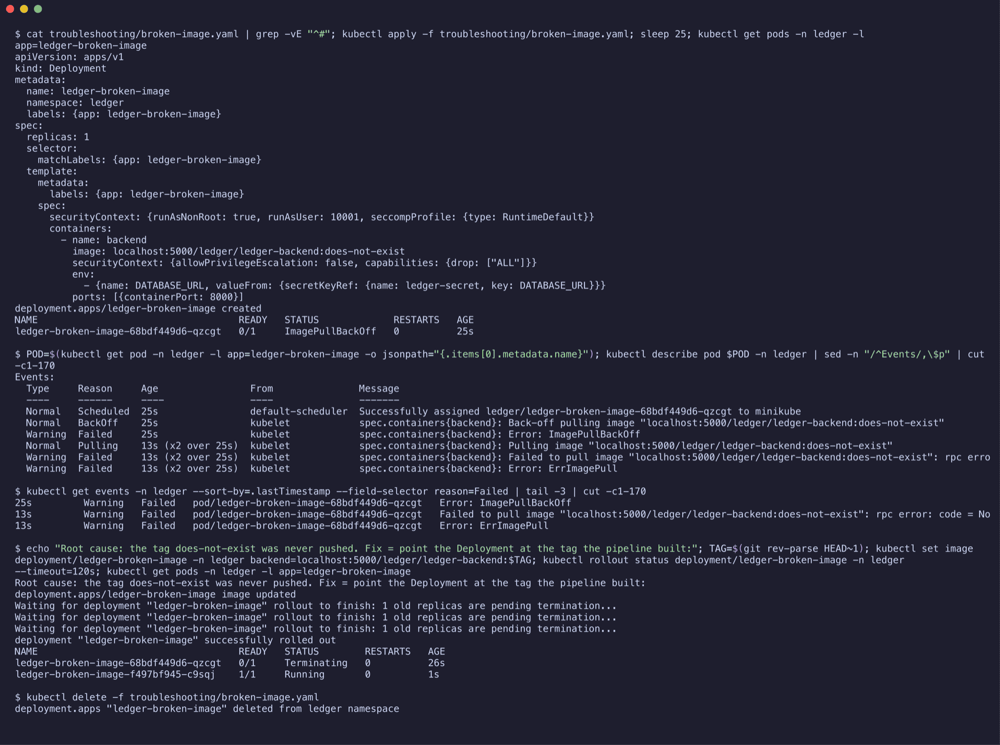

## `troubleshooting/broken-service.yaml` — a Service with no endpoints

A Service whose selector (`app: label-that-does-not-exist`) matches no pod. `kubectl get endpoints`
shows `<none>` and a request to it is refused. Investigation: compare `spec.selector` with
`kubectl get pods --show-labels`. Fix: patch the selector to the labels the backend pods really carry.
One detail worth knowing: a merge patch *keeps* keys you don't mention, so the wrong `app` key has to be
set to `null` explicitly — my first attempt that forgot this still had `<none>` endpoints.

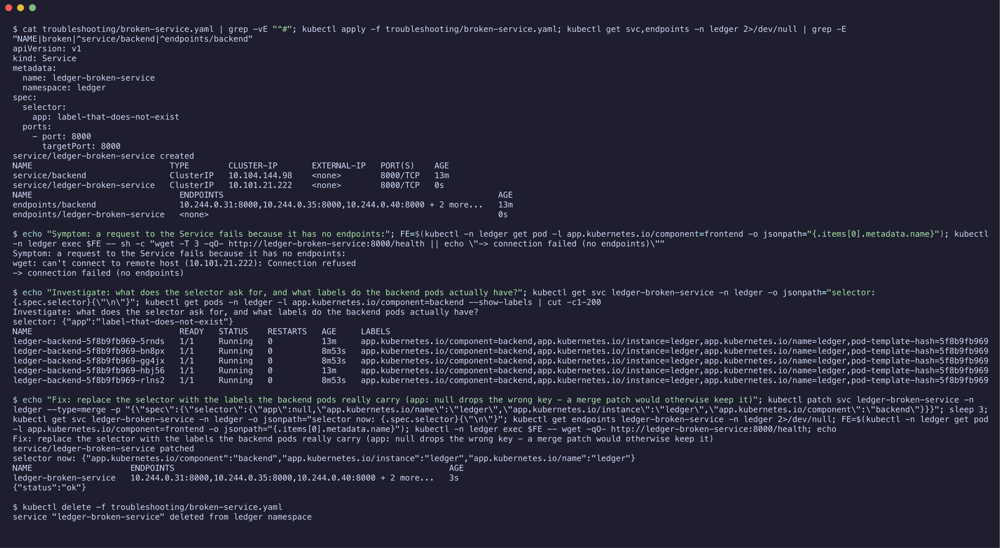

---

# 11. Final demo — a change travels from commit to cluster

The closing demonstration: a small application change (new tagline on the dashboard, app version
1.1.0), committed and pushed. The pipeline runs all three jobs, the images get the new commit's SHA as
their tag, Helm rolls the release to revision 2 with zero downtime (`maxUnavailable: 0`), and the
change is visible through the Ingress. In the cluster the API reports the commit SHA as its version,
because the chart sets `APP_VERSION` to the image tag — one more way to see exactly what is running.

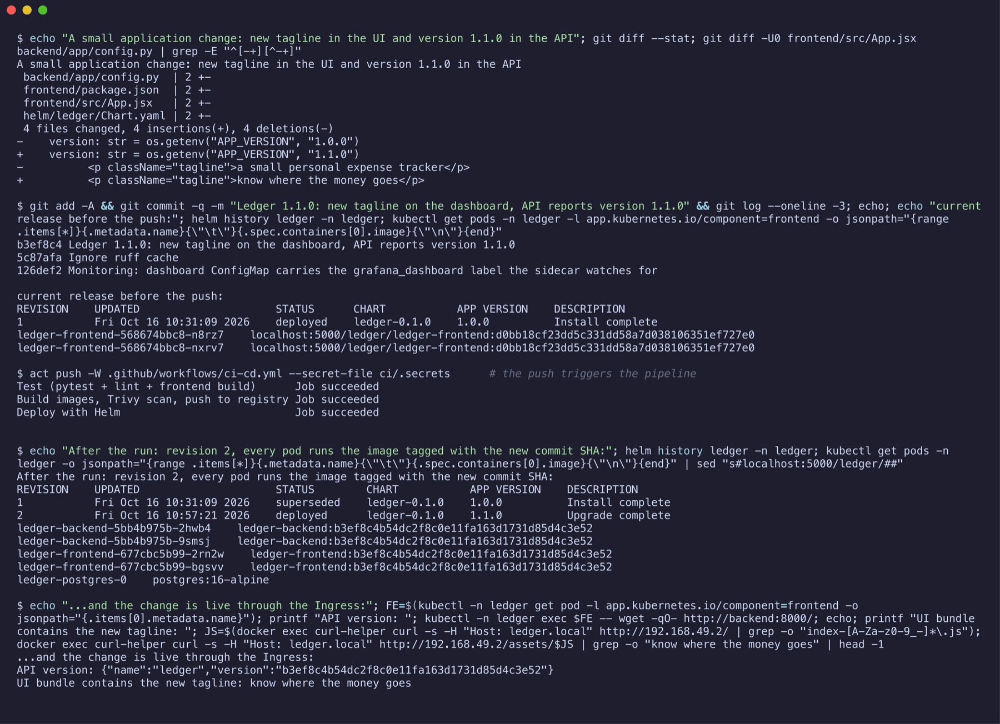

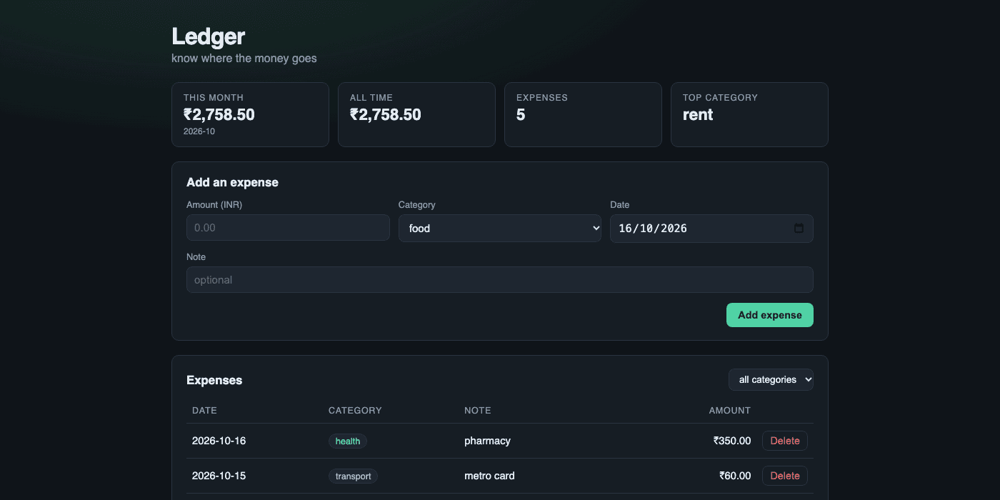

---

# What I understood

- **Tests before images.** The pipeline's shape (`test` → `build-scan-push` → `deploy`) is the whole
  point: a red test or a fixable CVE stops the run before anything is pushed, so the cluster only ever
  sees images that passed both gates.
- **Tags are provenance.** SHA tags mean `kubectl get pods -o jsonpath` tells me exactly which commit is
  running; `latest` would tell me nothing.
- **Caches can hide security fixes.** `apk upgrade` in a Dockerfile only helps if the layer is actually
  rebuilt — which is why the pipeline builds with `--pull --no-cache`.
- **Readiness is not liveness.** `/health` says the process is alive; `/ready` says it can serve
  traffic (the DB answers). Kubernetes uses the first to restart pods and the second to decide who gets
  traffic, and the init containers make sure a pod never tries to serve before the schema exists.
- **A Service is just a label query.** No matching labels → no endpoints → connection refused. The same
  idea underlies the ServiceMonitor, the HPA target and the Ingress backend.
- **Terraform is a plan, not a click path.** The dependency graph (VPC → subnets → NAT → route tables →
  EKS) comes from attribute references; `plan` shows exactly what will happen before it happens, and
  `destroy` is how you make sure the bill stops.
